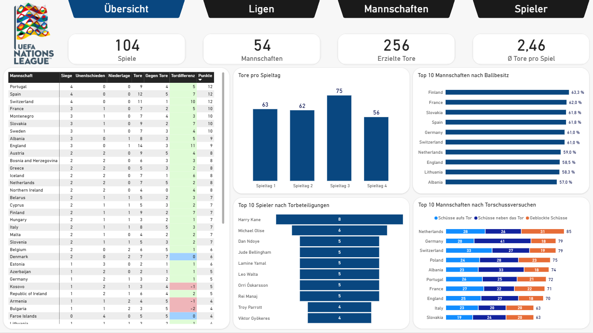

# UEFA Nations League - Power BI Case Study (#06)

###### Diese Case Study wurde vollständig in **Power BI** entwickelt und basiert auf einem **realen Datensatz zur UEFA Nations League** von Kaggle.

## Zusammenfassung:
Mit **Power Query** habe ich die Daten bereinigt und für die Analyse vorbereitet, bevor ich das **semantische Modell** in der **Modellansicht (Model View)** erstellt habe. Anschließend habe ich die erforderlichen Beziehungen und Kardinalitäten zwischen den Tabellen festgelegt, die benötigten **DAX Measures** erstellt und einen interaktiven **Power BI Bericht** mit vier Seiten entwickelt: **Übersicht, Ligen, Mannschaften und Spieler**.

Die wichtigsten Erkenntnisse aus diesem **UEFA Nations League Bericht** sind:
1. **Liga A liegt sowohl bei der Geschwindigkeit als auch bei der Genauigkeit an der Spitze, während Liga D das andere Ende der Rangliste bildet. Dies verdeutlicht die Leistungsunterschiede zwischen den höchsten und niedrigsten Ligastufen**
2. **Kleinere Nationen sowie Länder aus Ost- und Südosteuropa scheinen einen körperbetonteren Spielstil zu bevorzugen**
3. **Überraschenderweise erzielte Rasmus Højlund mit 36,8 km/h die höchste gemessene Höchstgeschwindigkeit des Wettbewerbs und ist damit bislang der schnellste Spieler**

###### Das finale Projekt ist vollständig funktionsfähig, alle Komponenten sind miteinander verbunden und getestet. Es vereint **Datenaufbereitung, Datenmodellierung, Visualisierung und Analyse** und orientiert sich an den zentralen **PL-300-Kompetenzen**.

## Objektiv:
Ziel dieses Projekts ist es, die Leistungen der vier Nations League **Ligen, Nationalmannschaften und Spieler** während des Wettbewerbs zu analysieren und miteinander zu vergleichen. Dabei liegt der Fokus darauf, Unterschiede zwischen den **Ligen** zu erkennen und **Nationalmannschaften** sowie **Spieler** anhand verschiedener Aspekte des Spiels zu vergleichen. Ziel ist es, einen besseren Überblick über den Wettbewerb zu gewinnen und interessante Erkenntnisse raus zu bringen.

**Zentrale Fragestellungen:**
1. **Wie unterscheiden sich die vier Ligen der Nations League?**
2. **Wie unterscheiden sich die Nationalmannschaften in verschiedenen Spielbereichen?**
3. **Welche Spieler stechen bei den wichtigsten Leistungskennzahlen hervor?**

## Methodik:
1. **Daten mit Power Query bereinigen, transformieren und für die Analyse vorbereiten**
2. **Ein semantisches Datenmodell in Power BI erstellen und DAX Measures für die Seiten Übersicht, Ligen, Mannschaften und Spieler entwickeln**
3. **Einen interaktiven Power BI Bericht erstellen, um wichtige Kennzahlen, Entwicklungen und Erkenntnisse zu visualisieren**

## Power BI Kenntnisse:
**Power Query:** Datenbereinigung, Transformation, Aufbereitung und Zusammenführung  
**Datenmodellierung:** Beziehungen, Kardinalitäten, Filter und Formatierung  
**DAX:** Measures, berechnete Spalten und berechnete Tabellen  
**Visualisierung:** Diagramme, Formatierung, KPI-Karten, Tooltips und visuelle Berechnungen  
**Analyse:** KPI-Analyse, Trendanalyse und Entwicklung interaktiver Berichte

## Ergebnisse & Empfehlungen:
Dieser Bericht bietet einen interaktiven Überblick über die **Ligen, Nationalmannschaften und Spieler** der UEFA Nations League. Durch die Zusammenführung dieser Bereiche in einem einzigen Bericht lassen sich wichtige KPIs einfacher überwachen, Trends erkennen und Leistungen miteinander vergleichen, ohne auf separate manuelle Analysen angewiesen zu sein.

Dieser Bericht hat zahlreiche wichtige Erkenntnisse aufgezeigt, wie zum Beispiel:

* **Übersicht Seite:** **Deutschland** gehörte bei den Torschussversuchen zu den Top 3, verzeichnete jedoch gleichzeitig die meisten Schüsse neben das Tor unter den Top 10. Mehr als **50 %** der Schüsse verfehlten das Tor. Trotz **79 Torschussversuchen** erzielte Deutschland lediglich **3 Tore**, was einer Trefferquote von nur **3,8 %** entspricht. Diese Zahlen deuten darauf hin, dass die deutschen Spieler vor dem Tor entschlossener agieren und ihre Schussgenauigkeit verbessern müssen.
* **Ligen Seite:** **Liga A** erzielte die meisten Tore, wies die höchste Schuss- und Passgenauigkeit sowie das schnellste Spieltempo auf und stellte die schnellsten Spieler. **Liga D** hingegen verzeichnete weniger Tore, eine geringere Genauigkeit und ein langsameres Spieltempo, war dafür aber mit Abstand die körperbetonteste Liga. Im Durchschnitt wurden dort **29,4 Fouls pro Spiel** begangen, verglichen mit **21,5** in Liga A. Dies verdeutlicht die unterschiedlichen Spielstile zwischen den höchsten und niedrigsten Ligastufen.
* **Mannschaften Seite:** **Norwegen** war überraschenderweise mit einer medianen Höchstgeschwindigkeit von **31,61 km/h** die schnellste Nation und lag damit knapp vor **Deutschland (31,59 km/h)**. **England** erzielte mit **14 Toren** die meisten Treffer und erreichte gleichzeitig die höchste Schussgenauigkeit von **20 %**, gleichauf mit **Spanien** – obwohl England **zehn Schüsse mehr** abgab. Diese Genauigkeit trotz einer deutlich höheren Anzahl an Versuchen beizubehalten, macht das Ergebnis umso beeindruckender. **Andorra** stach als körperbetonteste Mannschaft hervor und beging durchschnittlich **21,3 Fouls pro Spiel**.
* **Spieler Seite:** **Rasmus Højlund (DEN)** war mit Abstand der schnellste Spieler und erreichte eine Höchstgeschwindigkeit von **36,8 km/h**. **Martin Ødegaard (NOR)** legte mit **48,5 km** die größte Laufdistanz zurück und teilte sich mit **Jude Bellingham (ENG)** den ersten Platz bei den Vorlagen (jeweils **4**). Interessanterweise begingen Mittelfeldspieler mit durchschnittlich **2,54 Fouls pro Spieler** etwas mehr Fouls als Verteidiger (**2,48**) und waren damit die körperbetonteste Spielerposition.

Auf Grundlage dieser Analyse würde ich folgende Maßnahmen empfehlen:
1. **Schussgenauigkeit verbessern:** Die deutschen Spieler sollten vor dem Tor entschlossener agieren und sich darauf konzentrieren, ihre Schussgenauigkeit zu verbessern.
2. **Spieltempo und Genauigkeit statt körperbetonter Zweikämpfe in den Fokus stellen:** Mannschaften aus den unteren Ligen sollten sich stärker auf die Verbesserung ihres Spieltempos, ihrer Passgenauigkeit und ihrer allgemeinen technischen Leistung konzentrieren, anstatt sich zu sehr auf körperbetonte Zweikämpfe zu verlassen. Dadurch könnten sie wettbewerbsfähiger werden und den Leistungsabstand zu den höheren Ligen verringern.
3. **Spielerstatistiken als Grundlage für Kaderentscheidungen nutzen:** Nationalmannschaften sollten Spielerstatistiken nutzen, um ihre leistungsstärksten Spieler zu identifizieren und fundiertere Entscheidungen bei der Spielerauswahl und Rollenverteilung zu treffen. Kennzahlen wie Tore, Vorlagen, Schussgenauigkeit, Passgenauigkeit, zurückgelegte Distanz und Höchstgeschwindigkeit können dabei helfen, die Spieler zu identifizieren, die den größten Mehrwert für die Mannschaft bieten.

Ich bin überzeugt, dass diese Empfehlungen den Nationalmannschaften dabei helfen würden, ihre Gesamtleistung zu verbessern, die Stärken ihrer Spieler gezielter einzusetzen und wettbewerbsfähiger zu werden.

## Nächste Schritte:
1. **Analyse erweitern:** Die Leistungen der Mannschaften aus den vergangenen zwei Jahren analysieren, um Trends und Veränderungen im Zeitverlauf zu erkennen
2. **Wettbewerb weiterverfolgen:** Den weiteren Verlauf des Wettbewerbs abwarten, anschließend den Datensatz aktualisieren und die Ergebnisse weiter analysieren
3. **Bericht erweitern:** Weitere Seiten hinzufügen, beispielsweise eine Spieltagsanalyse, und detailliertere Statistiken zu Mannschaften und Spielern einbeziehen
